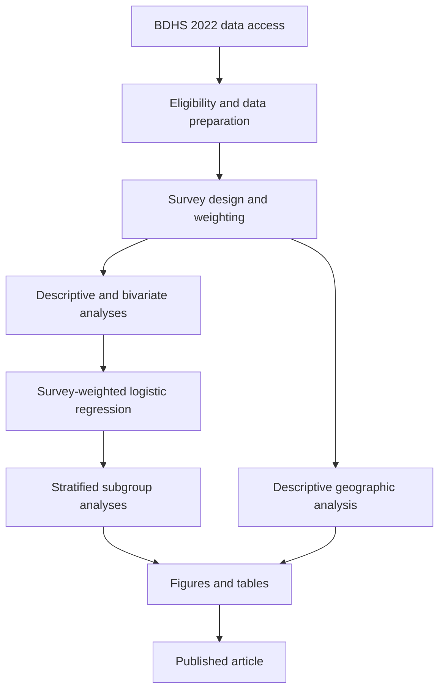

<div align="center">


# Internet Use and Unmet Need for Family Planning among Currently Pregnant Women in Bangladesh

### Evidence from the Bangladesh Demographic and Health Survey (BDHS) 2022

[](https://doi.org/10.1186/s12905-026-04788-2)
[](https://doi.org/10.1186/s12905-026-04788-2)
[](https://doi.org/10.1186/s12905-026-04788-2)


**[Published Article](https://doi.org/10.1186/s12905-026-04788-2) · [GitHub Repository](https://github.com/muhammadsalek/BDHS-Unmet-Need-Analysis) · [Research Tutorials](https://www.youtube.com/@SalekResearch)**

</div>

---

## Authors and Affiliations

| First Author | Corresponding Author |
|:---|:---|
| **Md Salek Miah** | **Md Jamal Uddin** |
| Department of Statistics, Shahjalal University of Science and Technology (SUST), Sylhet, Bangladesh | Department of Statistics, SUST; Faculty of Graduate Education, Daffodil International University, Bangladesh |
| [Email](mailto:saleksta@gmail.com) · [ORCID](https://orcid.org/0009-0005-5973-461X) · [Google Scholar](https://scholar.google.com/citations?user=oV99NYoAAAAJ) · [LinkedIn](https://www.linkedin.com/in/md-salek-miah-b34309329/) | [Email](mailto:jamal-sta@sust.edu) · [ORCID](https://orcid.org/0000-0002-8360-3274) · [Google Scholar](https://scholar.google.com/citations?user=tMZWkOUAAAAJ) |

**Research group:** Biostatistics, Epidemiology, and Public Health Research Team, Department of Statistics, SUST.

## Citation

> Miah, M. S., & Uddin, M. J. (2026). Association between internet use and unmet need for family planning among currently pregnant women in Bangladesh: evidence from BDHS 2022. *BMC Women's Health, 26*, Article 645. https://doi.org/10.1186/s12905-026-04788-2

```bibtex
@article{MiahUddin2026InternetFamilyPlanning,
  author  = {Miah, Md Salek and Uddin, Md Jamal},
  title   = {Association between internet use and unmet need for family planning among currently pregnant women in Bangladesh: evidence from BDHS 2022},
  journal = {BMC Women's Health},
  year    = {2026},
  volume  = {26},
  pages   = {645},
  doi     = {10.1186/s12905-026-04788-2},
  url     = {https://doi.org/10.1186/s12905-026-04788-2}
}
```

**Official publication:** [Article page](https://link.springer.com/article/10.1186/s12905-026-04788-2) · [Full-text PDF](https://link.springer.com/content/pdf/10.1186/s12905-026-04788-2.pdf)

---

## Research Overview

This study examines the association between **internet use** and **unmet need for family planning** among **currently pregnant women in Bangladesh**. It uses nationally representative **BDHS 2022** data and combines survey-weighted statistical modeling with subgroup and descriptive geographic analyses.

**Research objectives**

1. Examine the association between internet use and unmet need for family planning.
2. Compare associations across urban and rural areas and administrative divisions.
3. Explore differences by age, age at first birth, education, and media access.

### Methodology at a Glance

| Component | Description |
|:--|:--|
| Data | Bangladesh Demographic and Health Survey (BDHS) 2022 |
| Study design | Cross-sectional secondary analysis |
| Population | Currently pregnant women aged 15–49 years |
| Analytic sample | **4,370** |
| Exposure | Internet use during the 12 months preceding the survey |
| Outcome | Unmet need for family planning, defined using pregnancy intention |
| Survey methods | Sampling weights, clustering, and stratification |
| Primary analysis | Survey-weighted multivariable logistic regression |
| Additional analyses | Stratified regression and descriptive divisional mapping |
| Main software | Stata 17; R 4.5.1 |

### Analytical Workflow



## Key Findings

| Measure | Published result |
|:--|:--|
| Study population | **n = 4,370** pregnant women |
| Prevalence of unmet need | **41%** |
| Internet use and unmet need | **aOR = 1.83** (95% CI: 1.52–2.20) |
| Early first birth (10–17 years), subgroup association | **aOR = 2.70** (95% CI: 1.91–3.82) |
| Age 25–34 years, subgroup association | **aOR = 2.41** (95% CI: 1.82–3.17) |
| No formal education, subgroup association | **aOR = 5.34** (95% CI: 1.70–16.71) |
| Barishal, subgroup association | **aOR = 3.24** (95% CI: 1.99–5.28) |
| Rajshahi, subgroup association | **aOR = 3.30** (95% CI: 1.62–6.72) |
| Sylhet, subgroup association | **aOR = 2.98** (95% CI: 1.96–4.53) |
| Highest descriptive divisional prevalence | **Chattogram** |

**Interpretation:** The study found an association between internet use and unmet need for family planning; **cross-sectional data do not establish causation**. Subgroup estimates compare internet users and non-users **within each subgroup**, not one subgroup against another.

---

## Repository Organization

The numbered directories separate analysis scripts, data documentation, research outputs, publication materials, and reproducibility instructions. **Directory listings describe the intended organization; individual files are accessible only after upload.**

```text
BDHS-Unmet-Need-Analysis/
├── README.md                              # This page; keep at repository root
├── LICENSE
├── .gitignore
├── CITATION.cff                           # Optional citation metadata
│
├── 01_Code/
│   ├── Stata/
│   │   ├── Analysis.do                    # Main analysis, if present
│   │   └── Spatials.do                    # Spatial preparation, if present
│   └── R/
│       └── Spatial_Figures.R             # Geographic figures, if present
│
├── 02_Data/
│   ├── README.md                          # Data access and restrictions
│   └── Derived/
│       └── division_unmet_need_share.csv # Aggregate output, if cleared for sharing
│
├── 03_Outputs/
│   ├── Figures/
│   │   ├── Figure 1.pdf
│   │   └── Flowchart.tex
│   └── Tables/
│       ├── Table 1.docx
│       └── Table 2.docx
│
├── 04_Publication/
│   ├── Published_Version/
│   └── Supplementary_Materials/
│
├── 05_Peer_Review/                        # Only release where permission allows
│   ├── Round_1/
│   │   ├── Reviewer_Comments/
│   │   └── Response_Letters/
│   └── Round_2/
│       ├── Reviewer_Comments/
│       └── Response_Letters/
│
├── 06_Manuscript_Revisions/               # Only release permitted versions
│   ├── Initial_Submission/
│   ├── Revision_1/
│   ├── Revision_2/
│   └── Accepted_Version/
│
├── 07_AI_Reports/                         # Share non-confidential disclosures only
│   ├── AI_Declaration/
│   └── Similarity_Reports/
│
├── 08_Reproducibility/
│   └── README.md
│
└── 99_Archive/                            # Avoid posting sensitive old materials
```

### Navigate the Research Materials

| Section | Purpose |
|:--|:--|
| [`01_Code/`](01_Code/) | Stata and R analysis scripts |
| [`02_Data/`](02_Data/) | Data access notes and shareable aggregated outputs |
| [`03_Outputs/`](03_Outputs/) | Study figures and tables |
| [`04_Publication/`](04_Publication/) | Permitted published and supplementary materials |
| [`05_Peer_Review/`](05_Peer_Review/) | Peer-review documentation, **only if authorized for public release** |
| [`06_Manuscript_Revisions/`](06_Manuscript_Revisions/) | Manuscript versions, **subject to publication permissions** |
| [`07_AI_Reports/`](07_AI_Reports/) | Non-confidential AI declarations and related records |
| [`08_Reproducibility/`](08_Reproducibility/) | Setup, input requirements, and reproduction instructions |
| [`99_Archive/`](99_Archive/) | Non-confidential archived materials |

> **Important:** Reviewer reports, editorial correspondence, unpublished manuscripts, similarity reports, and restricted data should remain in **private storage** unless all necessary permissions for public release have been established. A folder name is not an authorization to publish its contents.

## Figures and Tables

- **Figure 1 — Participant selection:** [Open figure PDF](03_Outputs/Figures/Figure%201.pdf) *(available after this file is moved/uploaded)*.
- **Flowchart source:** [Flowchart.tex](03_Outputs/Figures/Flowchart.tex) *(available after upload)*.
- **Study tables:** [`03_Outputs/Tables/`](03_Outputs/Tables/) *(confirm final files before citing them)*.
- **Published figures and results:** [Official journal article](https://doi.org/10.1186/s12905-026-04788-2).

## Peer Review and Revision History

The manuscript underwent **two rounds of peer review** prior to publication. The editorial timeline reported in the published article is:

| Milestone | Date |
|:--|:--|
| Received | **8 March 2026** |
| Accepted | **10 August 2026** |
| Published online | **19 August 2026** |

Reviewer correspondence and revision documents are organized separately from the reproducible research code. They are **not necessary to run the statistical analysis**, and their public availability depends on the applicable journal policies and permissions.

## Data Source and Access

The study relies on **Bangladesh Demographic and Health Survey (BDHS) 2022** microdata obtained through the [DHS Program](https://dhsprogram.com/data/).

- **Individual-level DHS data are not distributed in this public repository.** Researchers should obtain their own authorized access from the DHS Program.
- The `02_Data/Derived/` directory is intended for outputs that are **aggregated, non-identifiable, and permitted to be shared**.
- A subset or modified Stata `.dta` file containing individual-level DHS respondents is **not automatically redistributable**.
- Geographic boundary files may have separate source and licensing requirements.

## Software and Reproducibility


### 1. Obtain the Required Data

Request BDHS 2022 access from the [DHS Program](https://dhsprogram.com/data/), and prepare the study-specific input files according to the analysis scripts.

### 2. Run the Stata Analysis

From the **repository root**, after updating all local input/output paths inside the scripts:

```stata
cd "/path/to/BDHS-Unmet-Need-Analysis"
do "01_Code/Stata/Analysis.do"
do "01_Code/Stata/Spatials.do"
```

> `Analysis.do` is included here as the intended main script name. Confirm it exists and check required input files before running. The scripts may require modifications if they contain old absolute paths or assume a prior folder layout.

### 3. Run the R Geographic Analysis

From the repository root in R, after checking the source script's dependencies and paths:

```r
setwd("/path/to/BDHS-Unmet-Need-Analysis")
source("01_Code/R/Spatial_Figures.R")
```

R package requirements should match the **actual source script**. See [`08_Reproducibility/`](08_Reproducibility/) for the documented setup once finalized.

### 4. Check Outputs

Compare generated tables and figures with the [published manuscript](https://doi.org/10.1186/s12905-026-04788-2). Any differences caused by software versions, variable coding, or sample restrictions should be documented.

**Reproducibility status:** The folder layout and instructions provide a foundation for reproducibility, but complete reproducibility should only be claimed after the shared scripts and permitted inputs have been tested end-to-end.

## Responsible Research and AI Disclosure

The published manuscript states that **Grammarly, QuillBot, and ChatGPT (GPT-4)** were used **for language improvement only** and not for data generation, statistical analysis, or interpretation. The relevant statement appears in the article's *Generative AI Assistance* section.

Any supporting declaration may be stored under `07_AI_Reports/AI_Declaration/` if it contains no confidential information and sharing is permitted.

## Research and Policy Relevance

The findings describe differences in family-planning needs across demographic and geographic subgroups and may help frame future research and targeted reproductive health programs. They do **not** establish that internet use causes unmet need to increase.

## Research and Data Analysis Tutorials

[](https://www.youtube.com/@SalekResearch)
[](https://github.com/muhammadsalek)

## License and Reuse

The published article states a **Creative Commons Attribution–NonCommercial–NoDerivatives 4.0 International (CC BY-NC-ND 4.0)** license. The repository's root [`LICENSE`](LICENSE) file describes the license applicable to **repository code**, where the code's authors have the right to license it. The article, third-party datasets, and figures may have different terms; the repository code license does not override those terms.

## Contact

**Md Salek Miah**  
Biostatistics, Epidemiology, and Public Health Research Team  
Department of Statistics, Shahjalal University of Science and Technology (SUST), Sylhet, Bangladesh  
Email: [saleksta@gmail.com](mailto:saleksta@gmail.com)  
[Google Scholar](https://scholar.google.com/citations?user=oV99NYoAAAAJ) · [ORCID](https://orcid.org/0009-0005-5973-461X) · [LinkedIn](https://www.linkedin.com/in/md-salek-miah-b34309329/)

<div align="center">

*Research code, documentation, and responsibly shared outputs supporting a peer-reviewed publication.*


</div>
